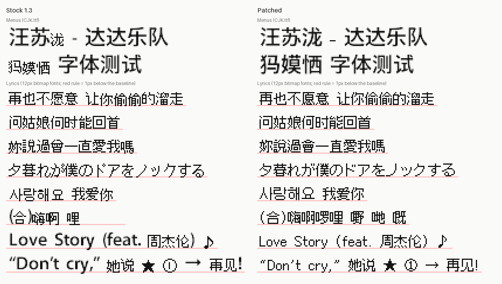

# iPod CJK Patch

**让原厂固件 1.3 的 iPod Video 5G/5.5G 清晰显示中日韩文字。**

[English](README.md) | **简体中文** | [日本語](README.ja.md) | [한국어](README.ko.md)

让运行苹果原厂固件 **1.3**（`iPod_25.1.3.ipsw`）的 **iPod Video 5G/5.5G** 正确显示中文、日文和韩文。
这不是 Rockbox：苹果固件照常使用，只是字体变了。iPod 里的音乐不受影响。

原厂固件的中日韩歌词会混用四套点阵字体，导致字符上下跳动 1–2 像素、同一行里字形风格不一致，有些字
（啰、嘢、哋 等）干脆显示不出来。同一行里的英文字母和符号又来自另一套加粗、抗锯齿的字体。菜单文字（歌名、歌手、专辑名）也缺不少简体字（泷、犸 等）。



<sub>由 `tools/render_preview.py` 用各固件自带的字体数据渲染（放大 3 倍）。原厂一侧每个字先用 Podium Sans 16，
没有的再按固件字体注册表顺序选用第一个包含它的 12px 字体；真机对中日韩字符的实际查找顺序略有不同，但混用
字体的情况是一样的。</sub>

> **风险自负。** 本工具会写入 iPod 的固件分区。刷写脚本会尽可能做各种检查，并先做备份；用 Finder/iTunes
> 恢复也总能救回 iPod，但会清空里面的音乐。

## 改了什么

- **歌词（编译在系统映像中的 12px 点阵字体）。** 所有中日韩字符（约 1.95 万个：汉字、假名、韩文、中日韩
  标点、全角字符）都改用 [Fusion Pixel 12px](https://github.com/TakWolf/fusion-pixel-font)（OFL）重新绘制，
  共用同一个字格和同一条基线。每个字只存在于一个字体中，固件的字体回退顺序因此不再有影响。简体字用 zh_hans
  字形，繁体字用 zh_hant，日文专用汉字和假名用 ja，韩文用 ko。原厂缺失的字已补上，康熙部首形近字
  （⼀ ⼩ ⾸ ⻋）映射到对应的常用字。
- **歌词中的英文和符号（Podium Sans 16，同样在系统映像中）。** 歌词里所有非中日韩字符都用这套加粗、抗锯齿的
  字体显示，所以英文单词、括号和引号比旁边的中日韩字符粗。现在它的字形改用 Fusion Pixel 12px 比例宽度版
  重新绘制，与中日韩字符共用同一条基线。原厂只在中日韩字体里才有的符号（♪ ★ ① → ※、制表符等）也移到这个
  字体中，每个符号只有一种样式。Fusion Pixel 没有的字符（越南语等少见的带变音符号字母、苹果的私有图标）
  保留原厂字形。歌词界面以外如果也用到 Podium Sans 16，那里的文字也会同样改变。
- **菜单 / 正在播放（资源卷中的 `CJK.ttf`，18px 4 位灰度）。** 新增 630 个字形：GB2312 中原本缺失的全部
  字符，以及 `charsets/menu.txt` 里的字。这些字形从冬青黑体简体中文 W6（Hiragino Sans GB）栅格化而来，
  与原有的 Hiragino 字形风格一致。

## 环境要求

- 固件 1.3 的 iPod Video 5G 或 5.5G（已在 5.5G 上测试），**Mac 格式**（Windows/FAT32 格式的 iPod 分区
  布局不同，刷写脚本不支持）
- macOS：菜单字体需要系统自带的冬青黑体（Hiragino Sans GB），刷写需要 `diskutil`
- [uv](https://docs.astral.sh/uv/)（或 Python ≥ 3.11，并安装 `fonttools`、`pillow`、`mutagen`）
- 首次构建需要联网：原厂 `iPod_25.1.3.ipsw` 会从苹果服务器下载（苹果固件受版权保护，本仓库不包含）

## 构建

```bash
uv run python -I tools/build.py
```

该命令会把 `iPod_25.1.3.ipsw` 从苹果下载到 `build/`，并用已知的 SHA1
（`0f2dd984c5d56475bdf3c14b4bc7541b799f2c85`）和 SHA256 校验。苹果只通过明文 HTTP 提供这个文件，安全性
靠哈希校验保证。如果你已有 IPSW，可以用 `--ipsw path/to/iPod_25.1.3.ipsw` 跳过下载。

歌词字形来自 GitHub 上 Fusion Pixel 12px 的 BDF 发布包（v2026.09.25）。构建时也会下载它和比例宽度版
（用于英文和符号），用固定的 SHA256 校验，并缓存在 `build/` 中。

构建会生成 `build/Firmware-25.6.3-cjk`、原厂基准 `build/stock/Firmware-25.6.3` 和
`build/before-after.png`。构建是确定性的，脚本会告诉你输出是否与发布版本一致（SHA256
`bf83fc2e3c38ba82da93f4f058783bfe9ef38899f6eb6dbf93fae567239b97e8`）。

## 刷写（保留音乐）

1. 连接 iPod 并启用磁盘使用（或进入磁盘模式：按住 Menu+Select 重启，再按住 Select+Play）。
2. 用 `diskutil list` 找到它的磁盘编号。iPod 的 `diskNs2` 是 `Apple_MDFW` 分区。
3. 运行：

```bash
sudo zsh tools/backup_and_flash.sh /dev/diskN
```

脚本会先把分区表和固件分区备份到 `backups/`。只有 iPod 当前固件与 `build/stock/Firmware-25.6.3` 逐字节
一致时才会写入。它会先试运行，只写入有变化的扇区，读回校验，然后推出 iPod。之后重启 iPod（按住
Menu+Select）。

如果要在之前刷过的版本上更新，而不是在原厂固件上，传入 iPod 当前的映像和新映像：
`backup_and_flash.sh /dev/diskN <当前映像> <新映像>`。

## 回滚

写回脚本备份的固件分区（如果 iPod 无法启动，先进入磁盘模式）：

```bash
sudo dd if=backups/ipod-s2-YYYYMMDD-HHMMSS.img of=/dev/rdiskNs2 bs=1m
```

用 Finder/iTunes 恢复也可以，但会清空音乐。

## 添加字符

把字符追加到 `charsets/lyrics_extra.txt`（歌词）或 `charsets/menu.txt`（菜单），然后重新构建。
`lyrics_extra.txt` 中的非中日韩符号（如 ♫）会加入 Podium Sans 16。要找出你的
音乐库用到、但固件显示不好的字符：

```bash
uv run python -I tools/scan_library.py ~/Music/your-library build/Firmware-25.6.3-cjk report.json
```

它会列出所有 12px 字体中都没有的字符、存在于多个字体中的字符（原厂基线跳动的原因），以及标题/歌手/专辑中
`CJK.ttf` 缺失的字符。

`tools/make_test_track.py` 会给一段静音的短 `.m4a` 写入覆盖所有情况的标题、歌手、专辑和歌词。把它加入音乐
库，再在 iPod 上查看效果。

## 工具

| 文件 | 用途 |
|---|---|
| `tools/build.py` | 一键构建：下载并校验 IPSW、构建、渲染对比图 |
| `tools/build_unified.py` | 重建 `osos` 映像中的 12px 中日韩点阵字体 |
| `tools/build_latin.py` | 用 Fusion Pixel 重绘 Podium Sans 16（歌词中的英文和符号） |
| `tools/extend_cjk_ttf.py` | 向 `CJK.ttf` 的 18px EBDT 点阵追加字形 |
| `tools/build_rsrc.py` | 替换 `rsrc` FAT 卷中的文件并修正校验和 |
| `tools/install_firmware.py` | 原地修补设备的固件分区（只用标准库） |
| `tools/backup_and_flash.sh` | 备份 + 安全检查 + 调用 `install_firmware.py` |
| `tools/scan_library.py` | 报告音乐库中固件显示不好的字符 |
| `tools/render_preview.py` | 用两个固件的字体并排渲染文字（`docs/before-after.png`） |
| `tools/pixofont.py` | 固件点阵字体的解析/写入；`pixofont.py <fw>` 列出所有字体 |
| `tools/fat16.py`、`ipodfw.py`、`bdf.py`、`hiragino_raster.py` | 辅助读写工具 |

## 固件笔记（踩过的坑）

- 在 IPSW 文件中，每个映像的数据从目录项 `devOffset + 0x800` 开始（`rsrc` 还要加 `entryOffset`）；
  在设备上则从 `devOffset + 0x200` 开始。校验和是映像所有字节的 32 位累加和。
- `rsrc` 卷虽然标着 “FAT16”，实际是 FAT12。
- **12px 等宽字体的字形条带宽度必须 ≤ 32767 像素**（字形 x 坐标是有符号 16 位数）。超出后，超出部分的
  所有字形都显示为空白。苹果原厂最大的条带是 31836 像素，`build_unified.py` 以此为上限，每个字体约可容纳
  2400 个字形。
- 不要依赖固件的字体回退顺序，它并不按字体注册表顺序。让每个字只来自一个字体。
- 歌词先用 Podium Sans 16 显示，它没有的字符才回退到 12px 字体。同一行里不同字体的字形按字格底边对齐，
  而不是按字体声明的上升高度（从照片测得：Podium Sans 16 高 13 像素的括号与中日韩字符结束在同一行）。
- 点阵字体格式参考 iPodWizard 的 `Font.h`。

## 欢迎参与：支持更多 iPod 和固件版本

目前只在一台 **固件 1.3、Mac 格式的 iPod Video 5.5G** 上测试过。如果你有其他设备，欢迎帮忙让它支持更多人：

- **测试反馈：** 固件 1.3 的 5G（30/60GB），或 Windows 格式的 iPod。告诉我们哪些正常、哪些不正常，最好附上照片。
- **其他固件版本：** 1.2.x 及更早的 5G 固件，内部布局可能不同。
- **其他机型：** nano 和 classic 可能使用不同的固件格式。哪怕只是分析清楚它们的字体存放方式，也是很有用的第一步。

[CONTRIBUTING.md](CONTRIBUTING.md#porting-to-another-ipod-or-firmware)（英文）列出了哪些部分与当前机型和版本绑定，
另有专门的移植报告 issue 模板。

## 致谢

- 歌词字形来自 TakWolf 的 [Fusion Pixel Font](https://github.com/TakWolf/fusion-pixel-font)（OFL 1.1），它基于
  [Ark Pixel](https://github.com/TakWolf/ark-pixel-font)、[Cubic 11](https://github.com/ACh-K/Cubic-11) 和
  [Galmuri](https://github.com/quiple/galmuri)。
- [iPodWizard](https://sourceforge.net/projects/ipodwizard/)：其 `Font.h` 记录了固件点阵字体的格式，
  `tools/pixofont.py` 据此实现。
- 菜单字形在你的 Mac 上由系统字体冬青黑体（Hiragino Sans GB）栅格化，本仓库不包含任何 Hiragino 数据。
- 使用了 [fontTools](https://github.com/fonttools/fonttools)、[Pillow](https://python-pillow.org/) 和
  [mutagen](https://github.com/quodlibet/mutagen)。

iPod 是 Apple Inc. 的商标。本项目与苹果公司无关，也未获其认可。

## 许可

代码采用 MIT 许可（见 `LICENSE`）。Fusion Pixel 采用 SIL Open Font License 1.1，其许可文本和来源说明
在 `third_party/fusion-pixel/`。本仓库不包含任何字体文件、苹果固件或苹果字体。构建时会下载苹果的 IPSW 和
Fusion Pixel 发布包，并在本地修补固件，`build/` 已被 git 忽略。请勿公开分发构建出的固件映像。
